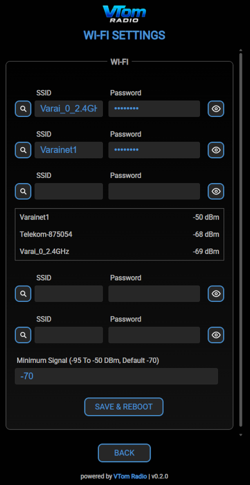

# A WI-FI kapcsolódás folyamata  

## 1. Beolvasás és inicializálás
- A rádió az induláskor beolvassa a /data/wifi.csv fájlt.     
- Legfeljebb 5 mentett SSID / jelszó pár fér el a memóriában.     
- A sorvégi vezérlőkaraktereket (\r, \n, szóközök) letisztítja, és támogatja az üres jelszavas (nyílt) hálózatokat is.
- Ha nincs mentett hálózat a rádió azonnal SoftAP (AP) módba lép.
## 2. Intelligens hálózatválasztás és csatlakozás
Induláskor a rádió nem vakon az utoljára használt hálózathoz próbál kapcsolódni, hanem egy intelligens kandidátus-listát állít össze:

- Wi-Fi pásztázás (Scan):   
A rádió végrehajt egy aszinkron Wi-Fi keresést (max. 12 másodperces időkorláttal).
- Szűrés és jelerősségi sorrend:    
    - Összeveti a talált hálózatokat a mentett listával.  
    - Kiszűri azokat, amelyek jelerőssége nem éri el a beállított minimumot (wifiMinRssi, pl. -70 dBm).  
    - A megfelelő mentett hálózatokat jelerősség szerint csökkenő sorrendbe rendezi (a legerősebb kerül a lista élére).
- Tartalék (Fallback) lista:
    - Ha a pásztázás nem talál megfelelő jelerősségű mentett hálózatot (vagy a scan sikertelen), a mentett hálózatokat tölti be tartalékként, az utoljára használt SSID-vel (lastSSID) kezdve.
- Próbálkozási ciklus (Candidates Loop):
    - A rádió sorban megpróbál csatlakozni a kiválasztott hálózatokhoz.
    - A kijelzőn kiírja a próbálkozás aktuális SSID-t.
    - Hálózatonként maximum 8 másodpercet (16 × 500 ms) vár a sikeres kapcsolatra.
- Siker esetén:     
    -  Elmenti ezt a hálózatot mint utoljára használtat (lastSSID), és elindul a normál rádió / lejátszó üzemmód.
    - Sikertelen próbálkozás esetén (pl. hibás jelszó vagy kiesett hálózat): BONTJA a kapcsolatot és azonnal próbálkozik a lista következő mentett hálózatával.
## 3. Sikertelen csatlakozás és AP mód     
- WEB / Rádió módban: Ha a lista végére érve egyetlen mentett hálózathoz sem tudott csatlakozni, a rádió átvált SoftAP (AP) módba (raiseSoftAP()), ahol a felhasználó a 192.168.4.1 címen (a wifiset.html oldalon) módosíthatja a beállításokat.
- SD kártya módban: Ha az SD kártyás lejátszás van aktívban, a rádió nem vált AP módba, hanem elindít egy háttértaskot (searchWiFi), ami 10 másodpercenként próbálkozik újra a Wi-Fi csatlakozással a háttérben, miközben az SD lejátszás zavartalanul fut.
## 4. Futás közbeni kapcsolatvesztés kezelése
- Ha lejátszás közben megszakad a Wi-Fi, a rádió leállítja a streamelést, zárolja az audió kimenetet, és a kijelzőn átvált LOST módra.  
- A háttérben a WiFi.reconnect() hívással próbálja visszaszerezni a kapcsolatot.
- Amikor a kapcsolat helyreáll, a rádió automatikusan visszatér PLAYER módba, és folytatja az utoljára hallgatott adó lejátszását.
- Ha a Wi-Fi kapcsolat nem áll helyre a háttérben végzett próbálkozások ellenére sem, a rádió új szkennelést indít, és megpróbál csatlakozni a megfelelő hálózatokhoz a fent leírt intelligens hálózatválasztási logika szerint.
## A WEB UI használata Wi-Fi beállításhoz   
- A nagyító használatával megjeleníthetőek az elérhető Wi-Fi hálózatok és a mentett beállítások a webes felületen.  
- A jelszó melletti szem gombbal megjeleníthető a jelszó és szükség esetén láthatóan szerkeszthető vagy törölhető.  
- Mostantól a jelszó nélküli nyílt hálózatok is használhatóak.
- A minimum szignálerősség (wifiMinRssi) beállítható a webes felületen, így a rádió csak azokat a hálózatokat használja a keresés során, amelyek jelerőssége eléri a beállított küszöböt. Így elkerülhető egy gyenge hálózathoz való kapcsolódás ami folyamatos szakadozást okozna.
    
    

### Ha támogatni szeretnéd a munkámat itt meghívhatsz egy kávéra!!!     
 

